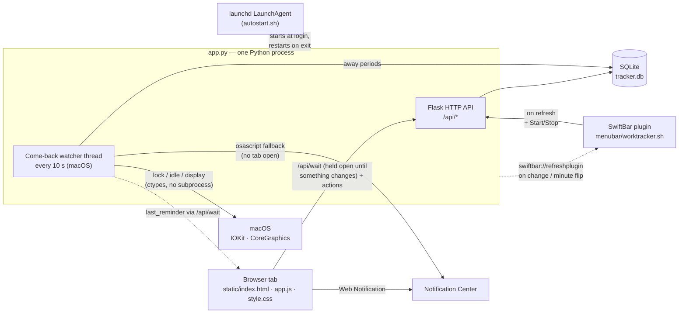

<h1 align="center">Work Tracker</h1>

<p align="center"><b>Your GitHub contribution graph — but for your working day.</b></p>

<p align="center">
  <a href="docs/work-tracker.mp4"></a>
</p>

<p align="center">
  <a href="#setup-guide">Setup guide</a> ·
  <a href="#daily-use">Daily use</a> ·
  <a href="#architecture">Architecture</a> ·
  <a href="#performance--footprint">Performance</a> ·
  <a href="docs/work-tracker.mp4">Video (MP4)</a>
</p>

A small, self-hosted work-time tracker. Start and stop a timer, see how much you've worked today and
this week against your work goal (40 h a week by default — change it any time), keep an overtime balance, and browse your history in a
GitHub-style heatmap. On macOS it can also start at login, remind you to start the timer when you
come back to your laptop, and live in the menu bar.

Everything runs locally: one Python process, one SQLite file, no accounts, no cloud.

## Table of contents

- [Features](#features)
- [Setup guide](#setup-guide) — step by step
  1. [Check that Python is installed](#step-1--check-that-python-is-installed)
  2. [Download and start Work Tracker](#step-2--download-and-start-work-tracker)
  3. [Open it in your browser](#step-3--open-it-in-your-browser)
  4. [Turn on reminders](#step-4--turn-on-reminders-macos-recommended) *(macOS, recommended)*
  5. [Start automatically at login](#step-5--start-automatically-at-login-macos-optional) *(macOS, optional)*
  6. [Menu bar item](#step-6--menu-bar-item-macos-optional) *(macOS, optional)*
- [Daily use](#daily-use)
  - [Track your time](#track-your-time) · [Read your stats](#read-your-stats) ·
    [Change your work goal](#change-your-work-goal) ·
    [Fix and add entries](#fix-and-add-entries) · [Add a lunch break](#add-a-lunch-break) ·
    [Forgot to stop the timer?](#forgot-to-stop-the-timer)
- [Configuration](#configuration)
- [Architecture](#architecture)
- [Tech stack](#tech-stack)
- [Performance & footprint](#performance--footprint)
- [Troubleshooting](#troubleshooting)
- [Project layout](#project-layout)
- [Uninstall](#uninstall)

---

## Features

| Feature | Platforms |
|---|---|
| **Timer** with a note of what you're working on (editable while it runs) | all |
| **Today / This week** vs. target, time left, when you'll be done | all |
| **Overtime balance** (days before today) and **overtime incl. today** (“if you stopped now”) | all |
| **Activity heatmap** for the last 12 months or any year | all |
| **Day view**: add, edit, delete sessions; **breaks** (e.g. lunch) that don't count as work | all |
| **Timeline per session**: when the Mac was in use vs. away; click any time to use it as start, end or break | all¹ |
| **Come-back reminder**: notification when you return to the Mac and no timer is running | macOS |
| **Work goal** you can change from any date on (e.g. 32 h on Mon–Thu) — past days keep theirs | all |
| **Settings** with a setup checklist and **Send test notification** | all |
| **Start at login** via a LaunchAgent | macOS |
| **Menu bar item** (SwiftBar plugin): running time, Start / Stop, today's stats | macOS |

¹ The timeline works everywhere; *away periods* (sleep, lock, lid closed) are only recorded on macOS.

---

## Setup guide

About 5 minutes. **Steps 1–3 are for everyone.** Steps 4–6 are optional extras for macOS — do 4,
skip the others if you don't need them. Every step ends with a **Check** so you know it worked.

> **Know your way around Python?** `git clone https://github.com/Steakbus/Work-Tracker.git && cd Work-Tracker && python3 -m venv .venv && .venv/bin/pip install -r requirements.txt && .venv/bin/python app.py`,
> then open <http://localhost:47474> and continue with [step 4](#step-4--turn-on-reminders-macos-recommended).

### Step 1 — Check that Python is installed

Open a terminal (**macOS:** *Applications → Utilities → Terminal* · **Windows:** *Start → “PowerShell”*)
and run:

```sh
python3 --version        # Windows: python --version
```

**Check:** It prints `Python 3.9` or newer.

<details>
<summary>It says “command not found” or a version below 3.9</summary>

- **macOS:** run `xcode-select --install` and confirm the dialog (or `brew install python`), then
  open a new terminal window.
- **Windows:** install Python from [python.org](https://www.python.org/downloads/) and tick
  **“Add python.exe to PATH”** in the first installer screen. Open a new PowerShell window.
- **Linux (Debian/Ubuntu):** `sudo apt install python3 python3-venv`
</details>

### Step 2 — Download and start Work Tracker

**macOS / Linux:**

```sh
git clone https://github.com/Steakbus/Work-Tracker.git
cd Work-Tracker
python3 -m venv .venv
.venv/bin/pip install -r requirements.txt
.venv/bin/python app.py
```

**Windows (PowerShell):**

```powershell
git clone https://github.com/Steakbus/Work-Tracker.git
cd Work-Tracker
python -m venv .venv
.venv\Scripts\pip install -r requirements.txt
.venv\Scripts\python app.py
```

No `git`? Download the ZIP via the green **Code** button on GitHub, unpack it, and `cd` into the folder.

**Check:** The terminal shows `Running on http://localhost:47474`.
**Leave this window open** — closing it stops the tracker. (On macOS, [step 5](#step-5--start-automatically-at-login-macos-optional)
makes it start by itself.)

### Step 3 — Open it in your browser

Go to **<http://localhost:47474>** and bookmark it. Tip: pin the tab (right-click the tab → *Pin*) so
it's always open — that's also what makes reminders work best.

**Check:** You see **Work Tracker** with a clock at `00:00:00` and a green **Start** button.

Your data lives in `tracker.db` in the Work-Tracker folder — back that file up if you care about your
history.

### Step 4 — Turn on reminders (macOS, recommended)

If you come back to your Mac (open the lid, unlock, wake the screen) and **no timer is running**,
Work Tracker sends a notification. Clicking it jumps to the tracker tab. If the timer runs, nothing
happens. Three switches must be on — the browser, macOS, and the tracker — so go through all of them:

1. In the tracker, click **Settings** (gear icon, top right; it's highlighted green until reminders are set up).
2. Click **Enable notifications** and choose **Allow** in the browser's popup.
3. **Allow your browser in macOS:** *System Settings → Notifications →* your browser (*Firefox*, *Google
   Chrome* or *Safari*) → turn on **Allow notifications** and pick a style other than *None*.
4. **Turn off Focus / Do Not Disturb** (moon icon in Control Center) — it silences notifications.
5. Back in Settings, click **Send test notification**.

**Check:** A notification **“Work Tracker – test notification”** appears. Both lines in Settings show a
green check mark.

<p align="center"></p>

<details>
<summary>No notification? Check the site permission in your browser</summary>

- **Firefox:** *Settings → Privacy & Security → Permissions → Notifications → Settings…* →
  `http://localhost:47474` must be **Allow**. Also make sure *“Pause notifications until Firefox
  restarts”* isn't ticked.
- **Chrome:** open `chrome://settings/content/notifications` → `http://localhost:47474` under
  **Allowed**.
- **Safari:** *Safari → Settings → Websites → Notifications* → `localhost` set to **Allow**.

Then press **Send test notification** again. If “Come-back reminders on this computer” says *off*,
you're not on macOS or started the server with `WAKE_PROMPT=0`.
</details>

Keep **one tracker tab open** (pinned, in the background is fine). Without an open tab you still get
a plain macOS notification, but clicking that one opens Script Editor instead of the tracker.

### Step 5 — Start automatically at login (macOS, optional)

Without this you have to run `.venv/bin/python app.py` again after every restart.

1. In the terminal from step 2, press **Ctrl + C** to stop the tracker (the background service needs
   port 47474 for itself).
2. In the Work-Tracker folder, run once:

   ```sh
   ./autostart.sh
   ```

   It reuses the `.venv` from step 2 and keeps the server running in the background — you can close
   the terminal afterwards.

**Check:** `launchctl list | grep worktracker` prints a line, and after a restart <http://localhost:47474>
works without opening a terminal.

To undo: `./autostart.sh remove`. Logs go to `tracker.log` in the same folder.

### Step 6 — Menu bar item (macOS, optional)

Shows the running time in the menu bar, with **Start**, **Start with note…** and **Stop** one click
away:

```text
3:12   (next to a timer icon)
├─ Running since 13:15 · API refactor: pagination
├─ ■ Stop
├─────────
├─ Today: 7h 02m / 8h 00m
├─ Week: 25h 59m / 40h 00m
├─ Overtime incl. today: +18h 17m
├─────────
└─ Open tracker
```

1. Install [SwiftBar](https://swiftbar.app): `brew install --cask swiftbar` (or download it from the
   website).
2. Start SwiftBar. When it asks for a **plugin folder**, choose the `menubar` folder inside
   Work-Tracker.
3. In SwiftBar's menu → *Preferences* → turn on **Launch at Login**.

**Check:** A timer icon appears in the menu bar. A warning triangle instead means the server isn't running (see step 5).

The plugin has no refresh interval: the server has SwiftBar re-run it when the text changes (Start/Stop
anywhere, the shown minute flips, a new day), and a run is a single `curl` to `http://localhost:47474` —
edit `URL` at the top of `menubar/worktracker.sh` if you changed the port.

---

## Daily use

### Track your time

Type what you're working on into the note field and press **Start** (or Enter). The clock keeps
running even if you close the browser — the timer lives on the server, not in the tab.

While the timer runs you can keep editing the note: press **Enter** or click elsewhere to save it.
Whatever is in the field when you press **Stop** is saved with the session. Only one timer runs at a
time.

### Read your stats


| Tile | Meaning |
|---|---|
| **Today** | Worked today vs. today's goal (0 h on days off). While running: when you'll reach it. |
| **This week** | Worked Monday–Sunday vs. this week's goal. |
| **Overtime balance** | Everything worked *before today* vs. the goal that was valid on each of those days, since your first entry. |
| **Overtime incl. today** | The balance plus today so far minus today's target — where you'd stand if you stopped now. |

**This week** shows one bar per day (the dashed line is that day's goal). The **heatmap** shows the last
12 months or any year from the dropdown; darker = more hours. Hover a day for its total, click it to
open it in the day view.

### Change your work goal

Working fewer (or more) hours from some date on? Open **Settings → Work goal**:

1. Enter your **hours per week**.
2. Tick your **workdays** — the hours are split evenly across them (32 h on Mon–Thu = 8 h per workday).
3. Pick the date it **starts** (today or later) and press **Save goal**.

<p align="center"></p>

Past days always keep the goal they had, so your overtime balance doesn't jump. A change that starts
in the future shows up as *planned* and can be cancelled until then. A change in the middle of a week
counts the old goal for the days before and the new one from that day on.

### Fix and add entries

The card at the bottom (the *day view*) lists the sessions of the selected day — today by default;
click a day in *This week* or the heatmap to see another one.

- **Edit** loads a session into the form below. This also works for the **running** timer: leave
  *End* empty to keep it running (**Save (keeps running)**), or fill it in to stop it at that time
  (**Save & stop**).
- **Delete** removes a finished session.
- **Add entry** creates a session from scratch, e.g. if you forgot to start the timer.

### Add a lunch break

Expand **▸ Timeline & break** under a session, set the two times and press **Add break**. The session
is split in two (same note), so the break doesn't count as work time anywhere — today, week, overtime
and heatmap. The day view shows the gap as *Break 12:30 – 13:15 · 0h 45m*. This also works on the
running timer once the break is over; the timer keeps running.

### Forgot to stop the timer?

On macOS the server notices when you're away — **Mac asleep**, **screen locked**, or **display off /
lid closed** — from your last keyboard or trackpad input until you're back. Under **Timeline &
break** each session shows a bar: **green** = Mac in use, **grey** = away, plus the list of away
periods.

Hover the bar to see the time under the pointer; **click** it to open a small menu. Grey parts snap
to when you left or came back, and the times in the away list are clickable too. The time can be
fine-tuned, then used as **Set as start**, **Set as end**, **Break from** or **Break until**. Nothing
is saved until you press *Save* / *Add break*.


Typical case: you closed the lid at 18:02 and only noticed the next morning that the timer was still
running. Expand the timeline → click the grey part → **Set as end** → **Save & stop**:


Away periods are only kept for the **last 3 sessions** (a handful of rows) — enough to fix
yesterday's mistake without the database growing.

---

## Configuration

| What | Where | Default |
|---|---|---|
| Work goal (hours per week, workdays) | **Settings → Work goal**, from any date on. `DAILY_TARGET` / `WORKDAYS` at the top of `app.py` are the defaults for days before your first change. | 40 h, Mon–Fri |
| Port | `PORT` environment variable | `47474` |
| Database file | `TRACKER_DB` environment variable | `tracker.db` next to `app.py` |
| Come-back watcher (reminders + away tracking) | `WAKE_PROMPT=0` disables it | on (macOS only) |
| Phone snapshot: a read-only `worktracker.html` (stats incl. overtime, this week, heatmap, every day with its sessions) rewritten after every change — point it at a OneDrive/iCloud folder and open it in the phone's Files app | `SNAPSHOT_DIR` environment variable (`SNAPSHOT_DIR=~/folder ./autostart.sh`) | off |

---

## Architecture



**How it fits together**

- **`app.py`** is the whole backend: a Flask app serving the static frontend and a small JSON API,
  plus (on macOS) a daemon thread — the *come-back watcher*. All times are stored as local ISO-8601
  strings; sessions spanning midnight are split per day when totals are computed.
- **The frontend** is plain HTML/CSS/JS with no build step. It renders from `/api/status` (one call
  returns everything the tiles need) and ticks only the running clock's text every second. It doesn't
  poll: `/api/wait` is held open by the server and answers when anything changes (or after 5 min).
- **The watcher** checks every 10 s whether the screen is locked, the display is asleep, or the wall
  clock jumped (= the Mac slept). When you're back (unlocked + recent keyboard/trackpad input) it
  stores the away period and, if no timer runs, bumps `last_reminder`; that answers the tabs'
  `/api/wait`, and a tab that may notify confirms with `/api/status?notify=1` and shows it (no
  confirmation within 15 s → macOS notification instead).
- **Breaks** don't need their own table: a break splits a session in two, so every total stays
  correct without special cases.

**Data model** (`tracker.db`)

| Table | Columns | Notes |
|---|---|---|
| `sessions` | `id`, `start_time`, `end_time` (NULL while running), `note` | indexed by `start_time` |
| `away` | `start_time`, `end_time`, `reason` (`sleep` · `lock` · `display-off`) | only rows overlapping the last 3 sessions are kept |
| `targets` | `valid_from`, `daily_seconds`, `workdays` | one row per goal change; before the first row the defaults apply |

**API**

| Method & path | Purpose |
|---|---|
| `GET /api/status` | Everything for the tiles: today, week, balance, running session, `last_reminder`, `watcher` |
| `GET /api/wait?v=…` | Held open until something changed since version `v` (max 5 min); replaces polling |
| `GET /api/menubar` | The SwiftBar plugin's menu text |
| `POST /api/test-notification` | Settings → *Send test notification* (same path as a real reminder) |
| `GET /api/goals` · `PUT /api/goals` | Work goal periods; set a new goal from today or a later date on |
| `DELETE /api/goals/<date>` | Cancel a goal change that hasn't started yet |
| `POST /api/start` · `POST /api/stop` | Start / stop the timer (optional `note`) |
| `GET /api/days?from=…&to=…` | Seconds per day, for the heatmap |
| `GET /api/sessions?date=…` | Sessions of a day, each with its `away` periods |
| `POST /api/sessions` | Add a finished session |
| `PUT /api/sessions/<id>` | Edit start / end / note (empty end keeps the running session running) |
| `PATCH /api/sessions/<id>` | Change only the note (also on the running session) |
| `POST /api/sessions/<id>/break` | Cut a break out of a session |
| `DELETE /api/sessions/<id>` | Delete a session |

---

## Tech stack

| Layer | Technology |
|---|---|
| Backend | Python 3.9+ · [Flask](https://flask.palletsprojects.com) 3 (the only dependency) |
| Storage | SQLite via Python's built-in `sqlite3` |
| Frontend | Vanilla HTML, CSS and JavaScript — no framework, no build step; light and dark mode |
| Notifications | Web Notifications API (browser tab) · `osascript` fallback |
| macOS integration | IOKit + CoreGraphics through `ctypes` (lock, idle, display state) · launchd LaunchAgent · [SwiftBar](https://swiftbar.app) |

About 1,500 lines in total, across 6 source files.

---

## Performance & footprint

Built to run all day without you noticing: nothing polls. Measured on 2026-10-17 on an Apple M5 Pro,
macOS 27, Python 3.12, Flask 3.1, with the Workflow module, idle with the timer stopped (5-minute
windows; wakeups = context switches):

| Component | Memory | CPU | Wakeups |
|---|---|---|---|
| Server (`run.py`, incl. watcher) | 41 MB (Flask ≈ 16 MB of it) | 90 ms per 5 min ≈ **0.03 %** of one core | ≈ 0.6/s, all from the watcher's 10 s check |
| Server accept loop alone | — | 0 | **0** (sleeps until a request comes) |
| Open tab | — | one `/api/wait` per 5 min while nothing changes | — |
| SwiftBar app | 78 MB | ≈ 0.01 % | ≈ 0.05/s |
| Menu bar plugin | 4 MB while it runs | < 10 ms per run; runs only when its text changes: once a minute while the timer runs, never while it's stopped | — |

Before (2026-10-17, same machine): the accept loop woke every 0.5 s (≈ 4 wakeups/s with the watcher),
the tab polled `/api/status` every 10 s and redrew the tiles every second, and SwiftBar started Python
for the plugin every 30 s (30 ms CPU and 16 MB per run, 2,880 runs a day) — about 0.17 % of a core
in total; now about 0.04 %.

| API latency (436 sessions, ~10 months of data) | p50 | p95 |
|---|---|---|
| `GET /api/status` | 2.0 ms | 2.7 ms |
| `GET /api/days` (12 months) | 1.7 ms | 2.3 ms |
| `GET /api/sessions` | 1.0 ms | 1.4 ms |

**Storage:** about 60 KB for 10 months of history (≈ 140 bytes per session). The `away` table holds
only the last 3 sessions' periods. `tracker.log` gets errors and one line per reminder decision — no
per-request access log, so it grows by a few lines a day.

**Choices that keep it light:** one process, no ORM, no frontend framework; lock/idle state read
in-process via IOKit instead of spawning `ioreg`; no polling anywhere — tabs hold `/api/wait` open and
the server has SwiftBar refresh the menu bar only when its text changes (a plugin that stays alive to
wait would cost more: SwiftBar polls a running plugin many times a second); only the clock's text
ticks every second, and only while the timer runs and the tab is visible; no infinite CSS animations.

---

## Troubleshooting

| Problem | Fix |
|---|---|
| “Address already in use” | Another program uses 47474 — start with `PORT=…` (and update the plugin's `URL`). |
| No reminder notification | Open **Settings** and press **Send test notification** — if that fails, follow [step 4](#step-4--turn-on-reminders-macos-recommended). If the test works but real reminders don't come, check `tracker.log` for `away (…)`, `back`, `reminder → …` lines. |
| Reminder click opens Script Editor | That's the fallback notification (no tracker tab open). Keep a tab open with reminders enabled. |
| Menu bar shows a warning triangle / page doesn't load | The server isn't running — run `./autostart.sh` (macOS) or `.venv/bin/python app.py`. |
| No grey parts on the timeline | Away periods are recorded only on macOS, only for absences ≥ 1 minute, and only kept for the last 3 sessions. |

---

## Project layout

```text
app.py                      backend: API, totals, come-back watcher
static/                     frontend: index.html, app.js, style.css
menubar/worktracker.sh      SwiftBar plugin (macOS)
autostart.sh                LaunchAgent install / remove (macOS)
docs/                       README images and video
requirements.txt            Flask
```

## Uninstall

```sh
./autostart.sh remove                 # macOS: stop and remove the LaunchAgent
brew uninstall --cask swiftbar        # if you installed it for the menu bar
rm -rf .venv tracker.db tracker.log   # careful: tracker.db is your history — back it up first
```
